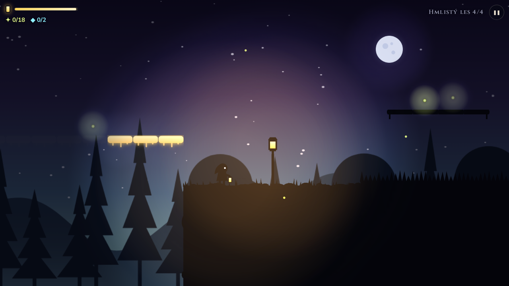
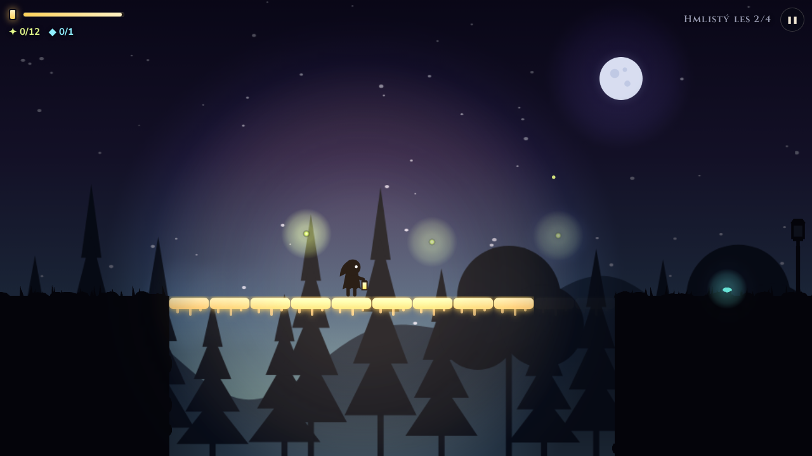
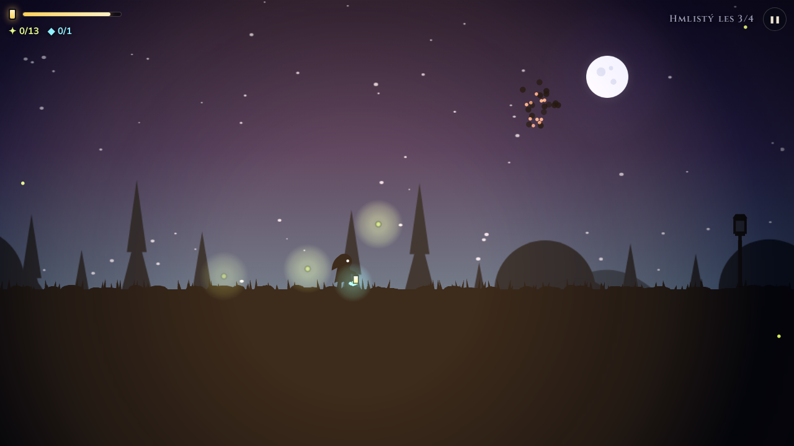
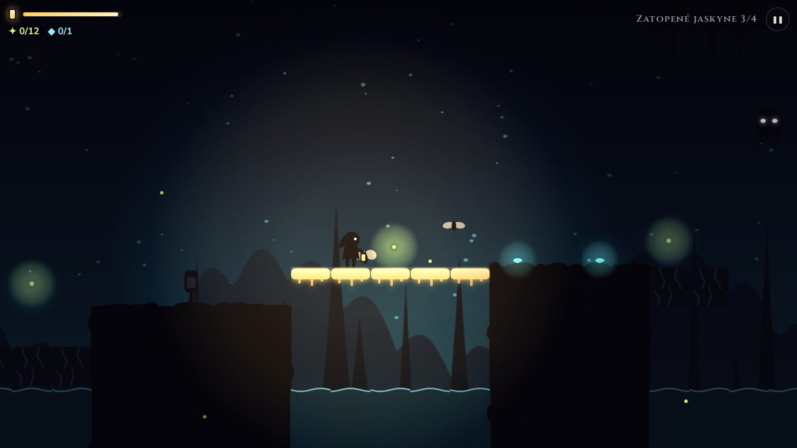
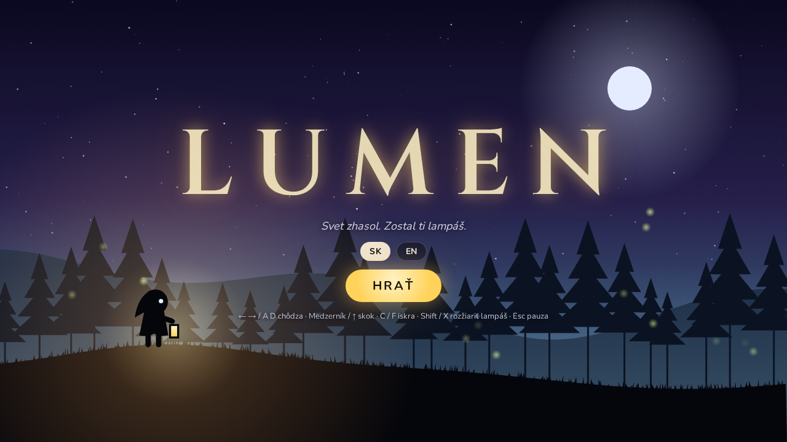
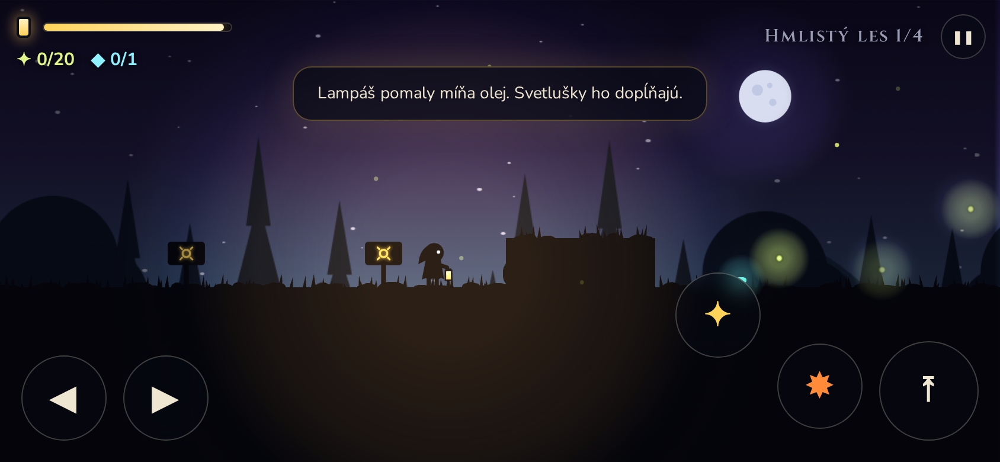

# Lumen

Siluetová plošinovka do prehliadača o malej postavičke s lampášom vo svete, ktorý zhasol.
Svetlo je všetko: ukazuje cestu, odháňa tiene a zhmotňuje svetelné plošiny. Olej v lampáši
však pomaly dochádza.

**▶ Hraj online: https://darangonaut.github.io/lumen/**



|                                                 |                                                               |
| ----------------------------------------------- | ------------------------------------------------------------- |
|    |  |
|  |                |
|            |                                                               |

## Ako sa hrá

- **Olej** v lampáši sa pomaly míňa. Dopĺňajú ho **svetlušky**. Keď dôjde, tma ťa pohltí.
- **Svetelné plošiny** existujú len vo svetle. Kam nedosvietiš, tam nestúpiš.
- **Rozžiarenie** (Shift / X / ✦) zväčší svetlo, ukáže vzdialené plošiny a spáli tiene,
  ale míňa veľa oleja.
- **Tiene** krúžia na okraji svetla a čakajú, kým zaváhaš. Ich dotyk ukradne olej.
  Poraziť ich môžeš **skokom na hlavu**, **iskrou** (stojí trochu oleja) alebo rozžiarením.
- **Mory** letia za svetlom a pijú olej z lampáša.
- V **Zatopených jaskyniach** číha ľadová voda a popraskané kamene, ktoré sa pod tebou rozpadnú.
- **Lampy** na stĺpoch sú checkpointy a doplnia olej. Pri nich si v bezpečí.
- Na konci každého levelu zapáľ **vatru**. Kto hľadá, nájde aj skryté **kryštály**.

## Ovládanie

| Akcia                   | Klávesnica        | Dotyk |
| ----------------------- | ----------------- | ----- |
| Chôdza                  | ← → / A D         | ◀ ▶   |
| Skok (podržaním vyššie) | Medzerník / ↑ / W | ⤒     |
| Zoskočiť z lávky        | ↓ / S             |       |
| Hodiť iskru             | C / F             | ✸     |
| Rozžiariť lampáš        | Shift / X         | ✦     |
| Pauza                   | Esc / P           | ❚❚    |

## Vývoj

TypeScript, Vite a PixiJS 8. Grafika je vektorová v siluetovom štýle (`src/render/vector.ts`): čierne popredie, žiariace pozadie, farbu má len svetlo. Všetka grafika aj zvuk sa generujú v kóde (žiadne obrázky ani
zvukové súbory). Herná logika v `src/game/` je čistý TypeScript bez PixiJS a DOM. Levely sú
ASCII mapy v `src/game/levels.ts` (2 svety po 4 leveloch: Hmlistý les a Zatopené jaskyne) a testy overujú, že sa dajú prejsť.

```bash
npm install
npm run dev          # vývojový server
npm test             # testy logiky a prejazdnosti levelov
npm run deploy:pages # nasadenie na GitHub Pages
```

Ladenie: `?debug&level=N` spustí rovno level N.
